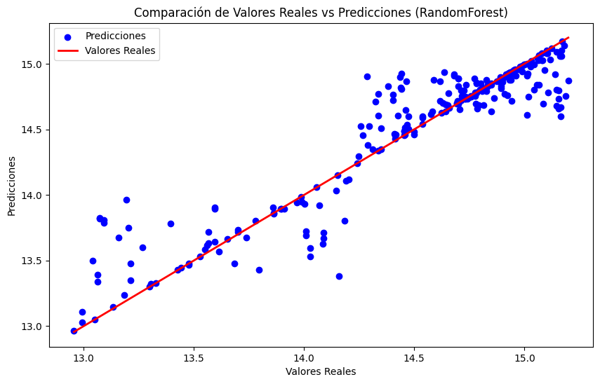

# Predicción del ingreso de clientes bancarios

[](https://colab.research.google.com/github/CesarGuarecuco/Customer-Revenue-Prediction-Algorithms/blob/main/prediccion_ingresos_clientes.ipynb) [](https://nbviewer.org/github/CesarGuarecuco/Customer-Revenue-Prediction-Algorithms/blob/main/prediccion_ingresos_clientes.ipynb)

Proyecto académico (2024). Estima el ingreso de un cliente a partir de sus datos (incluido el historial crediticio) y compara tres algoritmos, con y sin ajuste de hiperparámetros.

## Resultado

Random Forest ajustado con GridSearchCV es el mejor modelo: explica el **87%** de la variación del ingreso en los datos de prueba.

| Modelo | MSE | R² |
| --- | --- | --- |
| **Random Forest (ajustado)** | **0,048** | **0,866** |
| Random Forest (sin ajustar) | 0,054 | 0,852 |
| LightGBM (sin ajustar) | 0,065 | 0,821 |
| LightGBM (ajustado) | 0,071 | 0,803 |
| XGBoost | 0,117 | 0,675 |



## Qué incluye el notebook

1. Análisis exploratorio.
2. Conversión del historial crediticio a números (0 bueno, 1 regular, 2 malo).
3. División 75% entrenamiento y 25% prueba, y normalización.
4. Random Forest, XGBoost y LightGBM; ajuste de hiperparámetros con GridSearchCV.
5. Comparación con MSE y R².

## Datos

El archivo `banco.xlsx` no se incluye en el repositorio. Para ejecutar el notebook, déjalo junto al notebook.

## Cómo ejecutarlo

```bash
pip install -r requirements.txt
jupyter notebook prediccion_ingresos_clientes.ipynb
```

---

¿Necesitas un análisis o un modelo como este con los datos de tu organización? [Sivax Intelligence](https://sivax-intelligent.netlify.app/) · [sivax.contacto@gmail.com](mailto:sivax.contacto@gmail.com)
